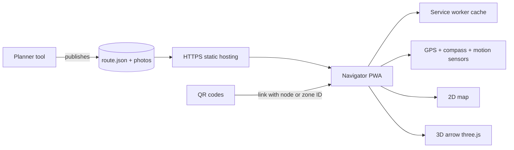

# VECV Plant Navigation: Development Guide

Version 1.0 (draft) · 4 November 2026 · Companion to the *Requirements and Understanding Document*

## 1. What you are building

Two web apps that share one JSON data file:

1. **Navigator (PWA):** runs in Chrome on Android and Safari on iPhone. Uses GPS and compass, no camera. Shows a 2D map, a 3D arrow, text steps and waypoint photos.
2. **Planner (admin tool):** edits waypoints, edges, zones, anchors, photos and QR links on the georeferenced plant layout, and saves the JSON. A first version (2D, image-based) exists and is the starting point.

WebXR, native apps and VPS are not part of version 1.

## 2. Architecture



- Static hosting over **HTTPS** is enough for version 1. HTTPS is required by browsers for location and motion sensors.
- The planner needs a login and a way to publish a new version of the JSON and photos. A small authenticated upload endpoint or a Git-based publish step is acceptable.
- No user accounts and no tracking in the navigator.

## 3. Suggested stack

| Layer | Choice | Note |
| --- | --- | --- |
| Language | TypeScript | Shared types for the JSON between planner and navigator |
| Build | Vite | Fast, simple PWA setup |
| Map | MapLibre GL JS | Supports your own image overlay or tiles and works offline. Google Maps JS is an alternative if you need its look, but it needs billing and has no offline mode |
| 3D arrow | three.js | Small scene: one arrow mesh, a light, a transparent canvas over the page |
| Routing | Own A\* on the graph | Small graph, no library needed |
| Offline | Service worker (Workbox) | Cache the app shell, JSON, map and the photos of the current zone |
| Testing | Vitest, Playwright, real phones | See section 10 |

## 4. Data model (single source of truth)

```json
{
  "schemaVersion": 1,
  "dataVersion": "2026-11-04.1",
  "site": { "name": "VECV Pithampur", "origin": [75.70, 22.60] },
  "zones": [
    { "id": "CMS1", "name": "CMS-1", "indoor": true,
      "polygon": [[75.7030,22.6010],[75.7050,22.6010],[75.7050,22.6025]] }
  ],
  "anchors": [
    { "id": "A12", "zone": "CMS1", "lat": 22.6012, "lon": 75.7034, "radiusM": 50 }
  ],
  "nodes": [
    { "id": "n5", "name": "CMS-1 Gate 2", "lat": 22.6012, "lon": 75.7034,
      "floor": 0, "zone": "CMS1", "type": "entrance",
      "names": { "hi": "सीएमएस-1 गेट 2" },
      "photos": [{ "file": "n5_approach.jpg", "caption": "Blue gate, yellow railing on your right", "captured": "2026-10-20" }] }
  ],
  "edges": [
    { "a": "n5", "b": "n6", "type": "walk" },
    { "a": "n9", "b": "n10", "type": "stairs" }
  ],
  "qr": [{ "id": "QR_CMS1_G2", "node": "n5" }]
}
```

Rules:

- Node `type`: waypoint, junction, entrance, destination, stairs, lift, crossing.
- Edge `type`: walk, stairs, lift, crossing. Edge length is computed from the coordinates and is not stored.
- Floors are integers (0 ground, 1 first floor, -1 basement).
- Validate on load: unique IDs, edges point to real nodes, every destination is reachable, every stairs edge joins different floors.
- Keep the old planner's normalized image coordinates only inside the planner. Convert to latitude and longitude on save using the georeference transform (section 8).

## 5. Navigator logic

**5.1 Starting position.** In order: (a) QR link `?node=ID` or `?zone=ID`; (b) GPS if accuracy is good and the position is inside an outdoor zone; (c) manual "choose where I am" picker.

**5.2 Location filtering.** Use `watchPosition` with high accuracy. Drop readings whose accuracy is worse than about 30 m. Smooth with a simple filter (exponential average or a basic Kalman). Show an accuracy circle on the map.

**5.3 Snapping.** Project the position to the nearest edge segment on the current floor. If the distance is more than about 25 m for several seconds, mark the user off-route and recalculate from the nearest node.

**5.4 Routing.** A\* over nodes and edges with distance as cost. Options: avoid stairs, outdoor only. Re-run on off-route, on floor change and on a destination change.

**5.5 Arrow angle.**

```
bearing = atan2( sin(dLon)*cos(lat2), cos(lat1)*sin(lat2) - sin(lat1)*cos(lat2)*cos(dLon) )
arrowAngle = bearing - heading     // rotate the 3D arrow about its vertical axis by this value
```

**5.6 Heading source.**

- iPhone: `webkitCompassHeading`, with `DeviceOrientationEvent.requestPermission()` called from a user tap (the Start button).
- Android Chrome: the `deviceorientationabsolute` event.
- Both: correct for screen rotation. When the user is walking, blend in the direction of travel from the last few GPS fixes; prefer it when speed is above about 1 m/s.
- Provide a Re-align button and a "hold the phone flat" hint.

**5.7 Indoor guided mode.** For zones with `indoor: true`:

- Do not use GPS for snapping.
- Start from the entrance QR or from a confirmed waypoint.
- Estimate progress along the current edge from step detection (accelerometer peaks) multiplied by a calibrated step length.
- Show the next waypoint photo from the start of each leg.
- Advance only when the user taps **I'm here** or the estimated distance has been walked. A tap always wins and resets the drift.

**5.8 Floors.** When the next edge is stairs or lift, show the instruction, the stairwell photo, and a confirm button for the new floor. A stairwell QR sets the floor directly. Without confirmation the app stays on the current floor.

**5.9 Anchors and loading.** Choose the nearest anchor within its radius, with hysteresis (switch only after the user is clearly inside the next one). Preload that zone's photos in the service worker.

**5.10 Safety.** On entering or approaching a `crossing` node or a flagged zone, show a short full-width warning ("Look up. Vehicles crossing") and dim the arrow.

## 6. Screens

1. **Start:** permission explanation, a big Start button (needed for the iPhone compass), language switch.
2. **Destination:** search box, recent, browse by zone.
3. **Navigation:** map on top (about 55%), the 3D arrow and the distance, the next-step text, the next waypoint thumbnail and the I'm here button. Larger text, high contrast, readable in sunlight.
4. **Photo viewer:** full-screen image with its caption and a Can't find it button that shows more photos.
5. **Arrived:** destination reached, with options to share or start another route.
6. **Fallback:** location or sensors denied. Offer manual start selection and a map-only mode.

## 7. Planner tool changes (from the existing prototype)

- Add the georeference step: the user pairs 4 to 6 points on the drawing with real coordinates. Compute an affine transform (or a projective one if the drawing is skewed) and display the RMS error. Block saving if the error is larger than the agreed limit.
- Add node fields: type, floor, zone, names in each language, photos, QR ID.
- Add edge types, anchors and zone polygons.
- Add photo attach from camera or gallery, with automatic resizing to about 1,000 px and a capture date.
- Add validation (reachability, orphan nodes, missing photos at decision points) and a route test using the simulated walker.
- Add an export that produces the JSON and a QR sheet (one printable QR per entrance and stairwell, encoding a link to the Navigator with the node ID).
- Add an admin login and a version number that increments on publish.

## 8. Surveying and data capture procedure

1. Collect or create at least 4 to 6 control points per area (gate corners, building corners), ideally measured with RTK GPS or taken from the surveyed CAD file. Record them in a table.
2. Georeference the layout in the planner and note the error per zone.
3. Draw routes and waypoints on the layout. Place waypoints at every junction, entrance, stairs, lift, crossing, and every 30 to 50 m on long straight runs.
4. Walk every route with a phone logging GPS. Compare with the drawn route and fix points more than a few metres off.
5. Take photos at decision points: eye height, from the direction of arrival, with permanent landmarks and a short caption. Check privacy and photography rules first.
6. Place QR codes at entrances and stairwells, and record their node IDs.

## 9. Offline and updates

- Cache the app shell and the data. Fetch `route.json` with a version check on load and show the current version in the app.
- Cache each zone's map and photos on first approach. Cap total storage and remove the oldest unused zone first.
- When a new data version is found, update in the background and apply it at the next route start, not mid-navigation.

## 10. Testing plan

| Test | How | Pass mark |
| --- | --- | --- |
| Unit | A\*, snapping, bearing, step detection, JSON validation | All green in CI |
| Simulation | Walker runs every route in the planner | Every destination reachable, no dead ends |
| Outdoor field | 30 points on roads and yards, 2 Android and 2 iPhone devices | 27 of 30 within about 10 m, correct next step |
| Indoor field | 10 first-time users, 5 destinations each | All reach their destination unaided |
| Stairs and basement | 20 runs | Floor change shown and confirmed correctly every time |
| Sensor behaviour | Near steel, motors and in a covered yard | Arrow error logged; fallback to walking direction works |
| Offline | Airplane mode after loading a zone | Routes and photos still work |
| Permissions | Deny location, deny motion, then allow | Fallback shown, no crash |
| Battery and heat | 30 minutes of continuous use | Within agreed limit, no throttling that breaks the arrow |
| Accessibility | Avoid-stairs route, text size, screen reader on key controls | Works as designed |

Build a diagnostics screen (hidden behind a long press) that shows GPS accuracy, heading source, snapped node, data version and sensor status. It will save hours during field testing.

## 11. Milestones

| Phase | Output | Exit check |
| --- | --- | --- |
| 0. Decisions | Open questions answered, devices chosen, photography approval | Requirements document signed |
| 1. Data foundation | Georeferenced layout, planner with new fields, a first set of routes | Data validates; routes pass simulation |
| 2. Navigator core | Location, snapping, routing, map, 3D arrow, text steps, simulated walker | Outdoor field test on a small area passes |
| 3. Indoor and floors | Guided mode, photos, I'm here, stairs, QR entry | Indoor tests on one shop and one stairwell pass |
| 4. Hardening | Offline, languages, safety prompts, diagnostics | Full acceptance tests on all devices |
| 5. Pilot | Real users in a limited zone for 2 to 4 weeks | Feedback fixed; go or no-go |
| 6. Review | Decide on VPS or Android AR upgrade from pilot results | Written recommendation |

## 12. Definition of done

- All Must requirements are met and the acceptance criteria in the Requirements Document pass.
- The app works on the agreed Android and iPhone versions.
- A non-developer can add a route and a photo in the planner and publish it.
- Documentation is handed over: data schema, survey procedure, QR printing and placement guide, and an operations note on updating data and photos.
- Known limits are written in the user-facing help: indoor guidance is approximate and the photo confirmation is the reference.

## 13. Upgrade path if the pilot shows accuracy is not enough

- **Indoor accuracy:** add VPS (for example Immersal) in a native app, or place UWB or BLE infrastructure in the most important shops. The JSON graph and photos remain valid.
- **AR arrows on Android:** add a WebXR mode that reuses the same graph and the heading alignment from GPS walking, without touching iPhone support.
- **Outdoor accuracy:** use RTK-corrected GNSS for staff-issued devices.
